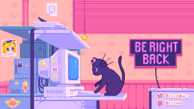

# 🌸 Welcome to my GitHub ˚˖❀⊹˖໒꒱₊⊹

I'm **Jessica Winola**, a third-year Computer Science student passionate about creating meaningful digital experiences. I enjoy bringing ideas to life through interactive web applications, exploring new technologies, and blending creativity with technology.

As someone with diverse interests across different fields, I love discovering new perspectives and finding ways to transform them into innovative technological solutions. My goal is to connect creativity, curiosity, and technology to create something that can inspire others.

Currently, I’m exploring Artificial Intelligence and continuously learning how technology can empower people to create more, not just consume.

 

  

---

## 🌷 About Me

- 🎓 Computer Science Student
- 💻 Frontend Web Developer
- 🎨 UI/UX Enthusiast
- 🌱 Currently learning React, Next.js & TypeScript
- ✨ Passionate about creating aesthetic and intuitive interfaces
- 💻 Love to explore many topics and implements to tech

---

## 💻 Tech Stack

### Languages

  

### Frameworks & Libraries

  

  
  

### Database

  

### Tools

  

  

---

## 📊 GitHub Analytics

  
  

  

---

## 🌸 Currently Working On

- 🎀 Personal Projects
- 📚 University Projects
- 🎨 UI/UX Exploration

---

## 📫 Let's Connect!

---

### ✨ Thanks for stopping by!

*"Keep learning, keep building, and never stop creating."*

